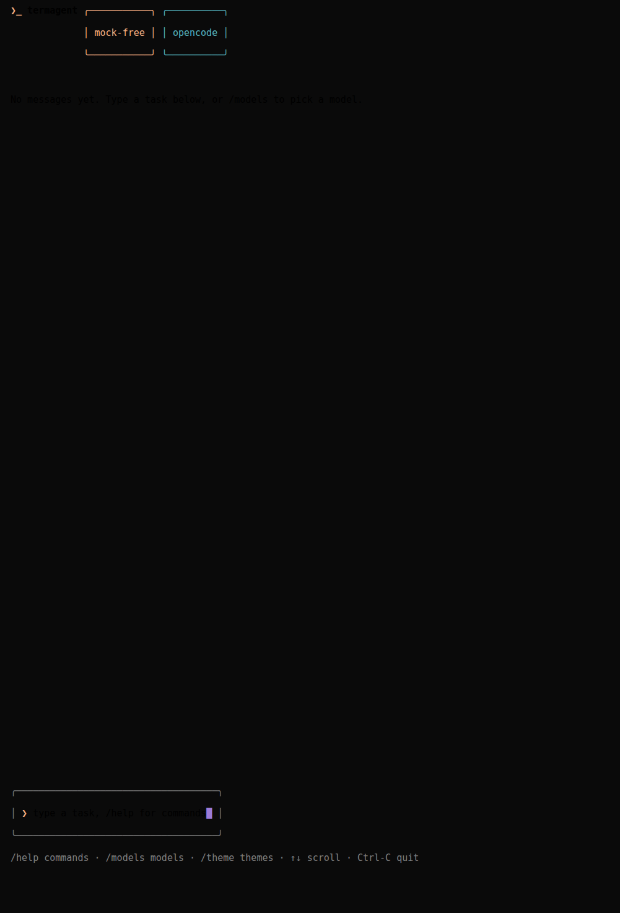
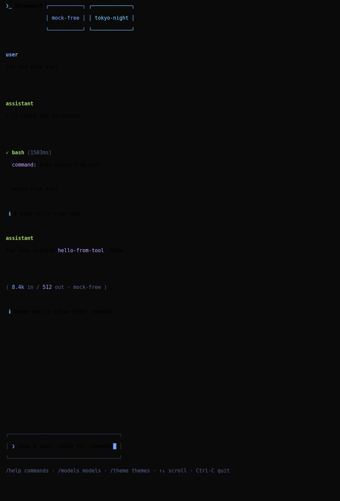

# termagent

A terminal AI coding agent — like `opencode`, `codex`, and `claude code` — rewritten in
**TypeScript** on [Ink](https://github.com/vadimdemedes/ink) with the UI component system of
[termcn](https://www.termcn.dev). Runs on any POSIX shell including **Termux (Android)**.

It speaks the **OpenAI-compatible Chat Completions API** (streaming, tool calling,
reasoning deltas, usage reporting), so it works with [OpenCode Zen](https://opencode.ai/zen)
(default), OpenAI, OpenRouter, Together, Groq, any `vLLM`/`llama.cpp`/`Ollama`/`LM Studio`
endpoint.

| startup | chat + tool call + usage |
|---|---|
|  |  |

| tool approval (risk badge) | model picker |
|---|---|
|  |  |

| live theme hot-swap (tokyo-night) | help |
|---|---|
|  |  |

## Features

- Full-screen Ink TUI on the termcn design system: `❯_` header with status badges,
  scrollable chat feed, bordered composer, hints footer
- **Real termcn components**: `ToolCall` (live braille spinner + duration),
  `ToolApproval` (risk badge, `[y] Approve / [n] Deny / [a] Always allow`),
  `ModelSelector` (grouped, arrow-key), `TokenUsage` (`⟨ 8.4k in / 512 out · model ⟩`),
  `ChatMessage`, `ThinkingBlock`, `DiffView`, `Badge`, `Panel`
- **17 termcn themes**, hot-swappable with `/theme` (persisted), `--theme`, `--list-themes`
- **Tools**: `bash`, `read`, `write`, `edit` (renders a colored diff), `ls`, `glob`,
  `grep` (ripgrep if present), `todo`
- **Approval gates** with risk classification: `rm -rf`, `curl | sh` and friends
  escalate to `HIGH`
- **Token usage per turn** via `stream_options.include_usage`; providers that reject
  the field are retried without it automatically
- **Reasoning support**: `reasoning_content` streams collapse into a `✻ Thought` block
  (`TERMAGENT_SHOW_REASONING=1` prints the full text)
- **Session save/resume** (`/save`, `/load`, `/sessions`) — same JSONL format as the
  earlier Python build, so old sessions load
- **Stale-model auto-heal**: if a saved Zen model id disappears upstream, the app
  switches to an available one and says so
- One-shot mode: `termagent "explain this repo"` (plain streaming, no TUI)
- Zero runtime dependencies beyond `ink` + `react` (+ `cli-spinners`, `string-width`)
- ASCII fallback (`TERMAGENT_ASCII=1`) for non-UTF terminals

## Provider status: OpenCode Zen free tier

Zen's free models used to work with no key from any client. **As of late 2026 the free
tier is gated server-side to the official OpenCode client** — third-party clients get
`403 FreeTierError`. termagent detects this and explains your options instead of dumping
JSON:

- Set a Zen API key ([opencode.ai/auth](https://opencode.ai/auth)), then `/models`
  lists all current Zen models.
- Or point at any other OpenAI-compatible endpoint (see below).

termagent does not spoof OpenCode's client headers to bypass the gate.

## Install

Requires Node 20+ (`pkg install nodejs git` on Termux).

```sh
git clone https://github.com/loak7993-code/termagent && cd termagent
npm install
npm run build
npm link                # or: npm install -g .
termagent
```

One-liner installer (Termux + Linux):

```sh
curl -fsSL https://raw.githubusercontent.com/loak7993-code/termagent/main/install.sh | bash
```

## Configure

Pick one:

```sh
# 1) Environment variables
export TERMAGENT_API_KEY="sk-..."        # or OPENAI_API_KEY
export TERMAGENT_BASE_URL="https://api.openai.com/v1"
export TERMAGENT_MODEL="gpt-4o-mini"

# 2) Interactive config (saved to ~/.config/termagent/config.json)
termagent --config
```

Other providers:

```sh
termagent -b https://opencode.ai/zen/v1 -k $ZEN_KEY -m glm-5.2
termagent -b https://openrouter.ai/api/v1 -k $OPENROUTER_KEY -m "anthropic/claude-3.5-sonnet"
termagent -b http://localhost:11434/v1 -k dummy -m llama3.1    # local Ollama
termagent -b http://localhost:1234/v1 -k dummy -m my-model     # LM Studio / llama.cpp
```

## Usage

```sh
termagent                      # interactive TUI
termagent "list the python files"   # one-shot
termagent -c /path/to/project  # working directory
termagent -a                   # auto-approve tool calls
termagent -s 20260721-214103-cc34ae  # resume a session
termagent --theme tokyo-night  # pick a UI theme
termagent --list-themes        # all 17 themes
```

Inside the TUI: type a task, or `/help` for all commands (`/models`, `/model`,
`/theme`, `/approve`, `/save`, `/load`, `/sessions`, `/cwd`, `/tools`, `/sys`,
`/clear`, `/paste`, `/config`, `/exit`). Arrow keys scroll the feed; overlays close
with `esc`.

## Configuration reference

| Variable / flag | Purpose | Default |
|---|---|---|
| `TERMAGENT_API_KEY` / `-k` | API key | empty |
| `TERMAGENT_BASE_URL` / `-b` | OpenAI-compatible base URL | `https://opencode.ai/zen/v1` |
| `TERMAGENT_MODEL` / `-m` | Model id | `big-pickle` |
| `TERMAGENT_THEME` / `--theme` | UI theme | `opencode` |
| `TERMAGENT_SHOW_REASONING` | print full reasoning text | off |
| `TERMAGENT_ASCII` | ASCII-only symbols and borders | off |
| `TERMAGENT_CONFIG_DIR` | config + sessions directory | `~/.config/termagent` |
| `--max-turns` | max agent turns per user message | 24 |
| `-a` / `--auto-approve` | approve tool calls without asking | off |

## Build, test, develop

```sh
npm install
npm run typecheck     # tsc --noEmit, strict
npm test              # vitest: 29 tests (agent loop vs mock SSE server, tools, themes, UI)
npm run build         # tsc -> dist/
npm link              # installs the `termagent` binary
```

To regenerate the UI screenshots: run the app inside tmux and capture panes (see
`docs/previews/` for the verified outputs).

## Architecture

```
src/
  cli.tsx            arg parsing, TUI bootstrap, one-shot mode
  app/
    App.tsx          app-shell layout, feed rendering, overlays
    store.ts         observable store bridging the agent loop to React
    commands.ts      slash commands, model/theme pickers
  agent/
    agent.ts         tool-calling loop (timing, usage, reasoning callbacks)
    client.ts        fetch-based SSE client (chunked tool-call accumulation, usage)
    config.ts        JSON config + env overrides
    zen.ts           OpenCode Zen catalog + live /models fetch
    session.ts       JSONL session save/resume (compatible with the Python build)
    tools/           bash, read, ls, glob, grep, write, edit, todo + registry
  components/ui/     vendored termcn components (shadcn registry, MIT)
  hooks/ providers/  vendored termcn hooks and theme/unicode providers
  lib/
    terminal-themes/ 17 termcn theme palettes (verbatim from the termcn registry)
    themes.ts        theme registry + resolution
tests/               vitest suite incl. a scripted OpenAI SSE mock server
docs/previews/       verified screenshots
```

## Known limitations

- Zen free tier is OpenCode-client-gated upstream (see above); the catalog covers
  chat-completions families only — Claude/Gemini/GPT-5.x on Zen use `/messages` or
  `/responses` and are excluded.
- The model picker shows the first 12 models; `/model <id>` sets any model directly.
- Reasoning content is summarized as a duration note unless
  `TERMAGENT_SHOW_REASONING=1`.
- One-shot mode is plain streaming output (no TUI), like `claude -p`.

## History

`v0.2.0-python` (tag) is the previous pure-Python implementation (`rich`-based,
termcn-styled). The TypeScript build replaces it; session files are compatible.

## Credits

UI components and themes from [termcn](https://www.termcn.dev) (MIT), rendered with
[Ink](https://github.com/vadimdemedes/ink). termagent is MIT.
