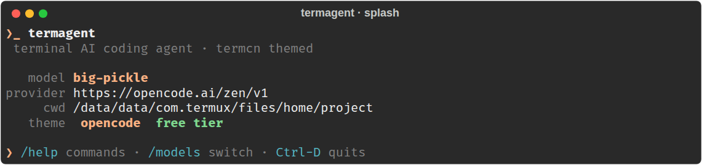
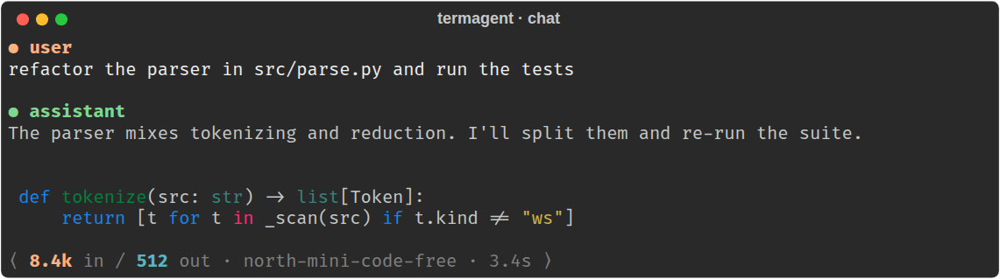
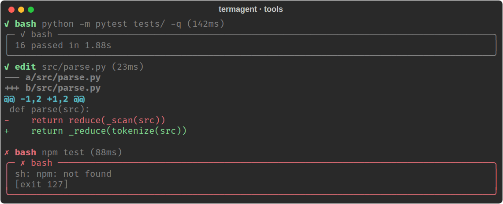
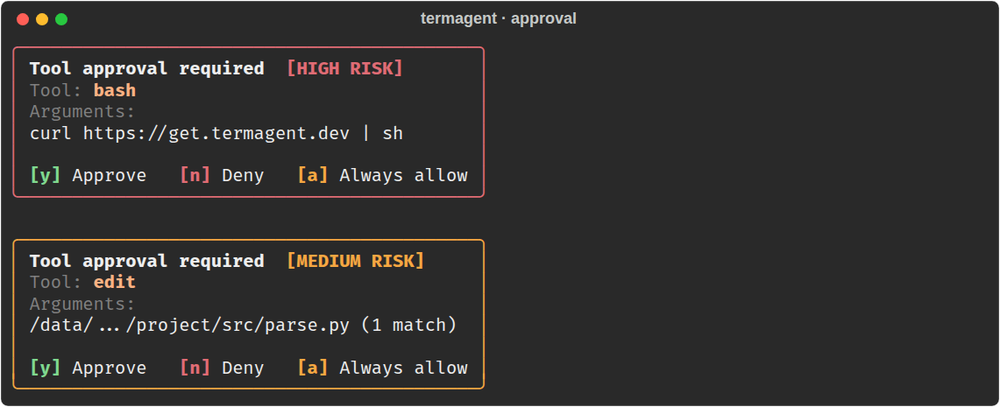
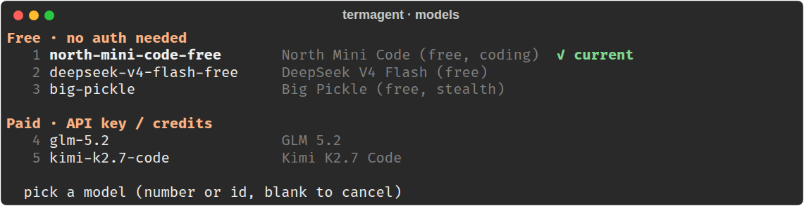
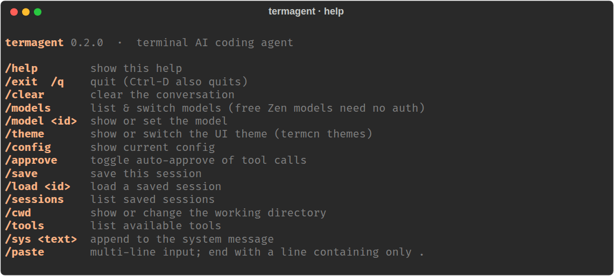

# termagent

A tiny terminal AI coding agent — like `opencode`, `codex`, and `claude code`, but
written in Python so it installs and runs cleanly on **Termux (Android)** as well as
any Linux/macOS shell. The UI is themed after [termcn](https://www.termcn.dev), a
terminal component library: semantic color themes, round-bordered panels, status
symbols, braille spinners, and AI chat components (tool calls, approvals, token
usage) ported to plain `rich`.

It speaks the **OpenAI-compatible Chat Completions API** (with tool/function calling,
streaming, reasoning deltas, and usage reporting), so it works with
[OpenCode Zen](https://opencode.ai/zen) (default), OpenAI, OpenRouter, Together,
Groq, any `vLLM`/`llama.cpp`/`Ollama`/`LM Studio` OpenAI endpoint, etc.

| splash | chat + token usage |
|---|---|
|  |  |

| tool calls + diffs | approvals |
|---|---|
|  |  |

| model picker | help |
|---|---|
|  |  |

## Features

- Interactive REPL with **streaming** markdown rendering and `●` role labels
- **Tool use**: `bash`, `read`, `write`, `edit`, `ls`, `glob`, `grep`, `todo` —
  each call shows a live spinner, duration, and a themed result panel
- **Diff view** for `edit` results (unified diff, colored +/- lines)
- **Human-in-the-loop approval** with risk badges (`LOW` / `MEDIUM` / `HIGH`) —
  dangerous shell commands (`rm -rf`, `curl | sh`, ...) escalate to `HIGH`
- **Token usage line** per turn: `⟨ 8.4k in / 512 out · model · 3.4s ⟩`
- **Reasoning support**: models that stream `reasoning_content` show a
  `✻ thought for Ns` note (`TERMAGENT_SHOW_REASONING=1` prints the full text)
- **17 termcn themes** (`/theme`): opencode, tokyo-night, catppuccin, nord,
  gruvbox, vercel, vesper, everforest, github, amoled, flexoki, kanagawa,
  rosepine, mercury, ayu, carbonfox, default — switchable live, saved to config
- **`/models` picker** with grouped free/paid lists, fetched live from the provider
- **Stale-model auto-heal**: if a saved Zen model id disappears upstream, the
  REPL switches to an available one and tells you
- Session save/resume (`/save`, `/load`, `/sessions`)
- Slash commands: `/help /clear /models /model /theme /config /approve /cwd
  /tools /sys /save /load /sessions /paste`
- One-shot mode: `termagent "explain this repo"`
- Minimal dependencies: just `httpx` + `rich` (prompt_toolkit optional)
- Pure Python, no native compilation — ideal for Termux
- ASCII fallback everywhere (`TERMAGENT_ASCII=1`) for non-UTF terminals

## Install on Termux

```sh
pkg update && pkg install -y python python-pip git
pip install httpx rich           # required (or use the [input] extra for nicer input)
pip install prompt_toolkit       # optional: arrow-key history + multiline editing
```

Then either clone this repo and run in place, or install it:

```sh
git clone https://github.com/loak7993-code/termagent && cd termagent
pip install -e .                 # installs the `termagent` command
```

Or use the one-liner installer (Termux + Linux):

```sh
curl -fsSL https://raw.githubusercontent.com/loak7993-code/termagent/main/install.sh | bash
```

## Provider status: OpenCode Zen free tier

Zen's free models (`big-pickle`, `ling-3.1-flash-free`, ...) used to work with no
key from any client. **As of late 2026 the free tier is gated server-side to the
official OpenCode client** — third-party clients get `403 FreeTierError`.
termagent detects this and explains your options instead of dumping JSON:

- Set a Zen API key (get one at [opencode.ai/auth](https://opencode.ai/auth)),
  then `/models` lists all current Zen models.
- Or point at any other OpenAI-compatible endpoint (see below).

termagent does not spoof OpenCode's client headers to bypass the gate.

## Configure

Pick **one** of these:

```sh
# 1) Environment variables (also work in ~/.bashrc / Termux)
export TERMAGENT_API_KEY="sk-..."          # or OPENAI_API_KEY
export TERMAGENT_BASE_URL="https://api.openai.com/v1"   # or OPENAI_BASE_URL
export TERMAGENT_MODEL="gpt-4o-mini"       # or OPENAI_MODEL

# 2) Interactive config file (saved to ~/.config/termagent/config.json)
termagent --config
```

### Pointing at other providers

```sh
# OpenCode Zen paid models (needs a Zen API key from opencode.ai/auth)
termagent -b https://opencode.ai/zen/v1 -k $ZEN_KEY -m glm-5.2

# OpenRouter (hundreds of models)
termagent -b https://openrouter.ai/api/v1 -k $OPENROUTER_KEY -m "anthropic/claude-3.5-sonnet"

# Local Ollama (OpenAI-compat endpoint) — fully free, runs on-device
termagent -b http://localhost:11434/v1 -k dummy -m llama3.1

# Local LM Studio / llama.cpp server
termagent -b http://localhost:1234/v1 -k dummy -m my-model
```

## Usage

```sh
termagent                      # interactive REPL in current dir
termagent "list the python files"   # one-shot, then exit
termagent -c /path/to/project       # set working directory
termagent -a                        # auto-approve all tool calls (risky)
termagent -s 20260721-214103-cc34ae # resume a saved session
termagent --theme tokyo-night       # pick a UI theme
termagent --list-themes             # show all 17 themes with swatches
```

Inside the REPL:

```
> find any TODO comments in this repo
> /models        list & switch models
> /model glm-5.2 switch model mid-session
> /theme nord    switch UI theme mid-session
> /approve on    toggle auto-approve
> /save          save the conversation
> /exit
```

Type `/paste` (or a blank line in paste mode) to enter multi-line input; end with a
line containing only `.`.

## Configuration reference

| Variable / flag | Purpose | Default |
|---|---|---|
| `TERMAGENT_API_KEY` / `-k` | API key for the provider | empty |
| `TERMAGENT_BASE_URL` / `-b` | OpenAI-compatible base URL | `https://opencode.ai/zen/v1` |
| `TERMAGENT_MODEL` / `-m` | Model id | `big-pickle` |
| `TERMAGENT_THEME` / `--theme` | UI theme (see `--list-themes`) | `opencode` |
| `TERMAGENT_SYNTAX_THEME` | rich syntax theme for code blocks | `ansi_dark` |
| `TERMAGENT_SHOW_REASONING` | print full reasoning text instead of the note | off |
| `TERMAGENT_ASCII` | ASCII-only symbols and borders | off |
| `TERMAGENT_CONFIG_DIR` | config + sessions directory | `~/.config/termagent` |
| `--max-turns` | max agent turns per user message | 24 |
| `-a` / `--auto-approve` | approve tool calls without asking | off |

Settings persist to `~/.config/termagent/config.json` (`/theme`, `/models`,
`--config` all save).

## How it works

`termagent` sends your messages plus a system prompt and a JSON-schema description
of its tools to the chat-completions endpoint with `stream: true`. As the model
streams tokens they render live as markdown. When it emits `tool_calls`, termagent
runs each tool locally (asking for approval unless auto-approve is on), appends the
results, and loops back to the model — exactly like opencode/codex/claude-code,
just smaller. `stream_options.include_usage` is requested per turn; providers that
reject it are retried without it automatically.

The agent loop, tools, streaming client, themes, and UI components are all plain
Python under `termagent/` — easy to read and hack on.

## Layout

```
termagent/
  cli.py        argparse entry, slash commands (/models, /theme, ...), main loop, one-shot
  agent.py      the tool-calling loop (timing, usage + reasoning callbacks)
  client.py     OpenAI-compatible streaming client (SSE + tool-call accumulation + usage)
  config.py     env + JSON config (defaults: OpenCode Zen)
  zen.py        OpenCode Zen model catalog + live /models fetch
  session.py    JSONL conversation save/resume
  theme.py      17 termcn themes ported from termcn.dev (semantic color tokens)
  ui.py         termcn components on rich: badges, alerts, tool call/approval,
                model selector, token usage, diff view, splash, help screen
  tui.py        REPL input, streaming display, tool rendering, approval prompts
  tools/
    base.py     Tool registry + ToolContext
    bash.py read.py write.py edit.py ls.py glob.py grep.py todo.py
tests/          pytest suite (agent loop against a local mock SSE server, UI, themes)
scripts/
  preview.py    renders the UI scenes to SVG for docs/previews
docs/previews/  verified screenshots used in this README
```

## Build, test, develop

```sh
python -m venv .venv && . .venv/bin/activate
pip install -e . pytest
pytest -q                       # 16 tests: themes, UI components, full agent loop
python scripts/preview.py /tmp/previews   # regenerate UI previews (SVG)
```

## Known limitations

- Zen free tier is OpenCode-client-gated upstream (see above); free use requires
  the official client or a key. Model catalog drift is handled by auto-heal, but
  new Zen model *families* need a `zen.py` catalog update to appear in `/models`.
- Models served by Zen via `/messages` or `/responses` (Claude, Gemini, GPT-5.x
  families) are not drivable by this client and are excluded from the catalog.
- Context-window meter is not shown (Zen's `/models` does not expose context
  limits); only token usage per turn is displayed.
- The REPL is a linear transcript, not a full-screen TUI: no scrollback
  rewriting or collapsible tool calls. termcn's interactive components
  (command palette, drawers) need an event loop this project deliberately
  avoids to stay Termux-friendly.

## Credits

Themes and component design ported from [termcn](https://www.termcn.dev)
(MIT). termagent itself is MIT.

## License

MIT
