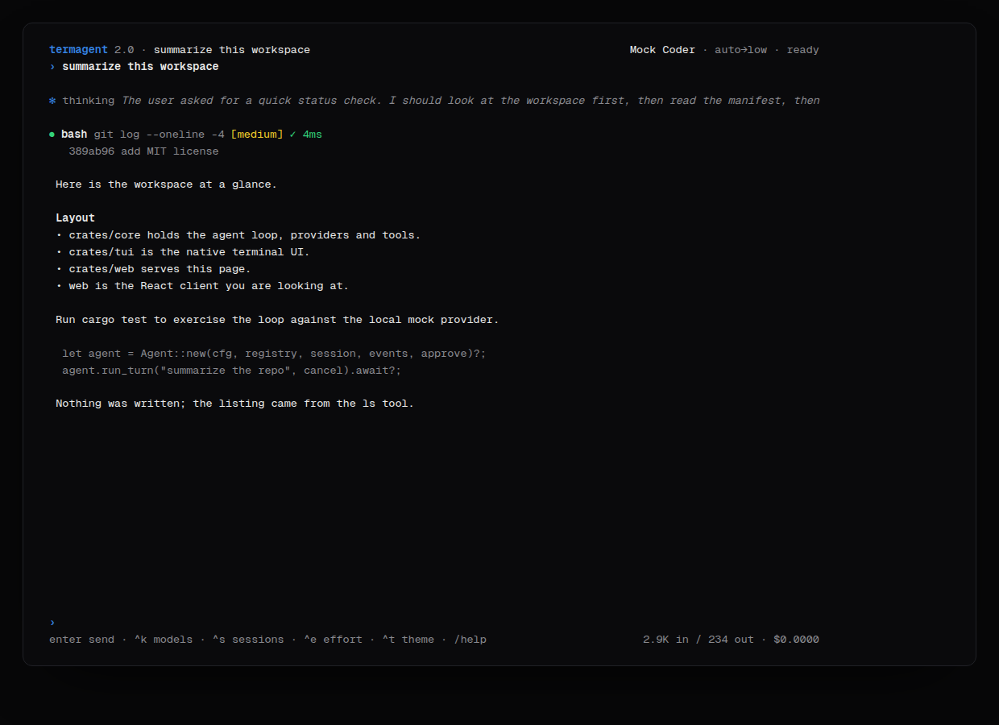
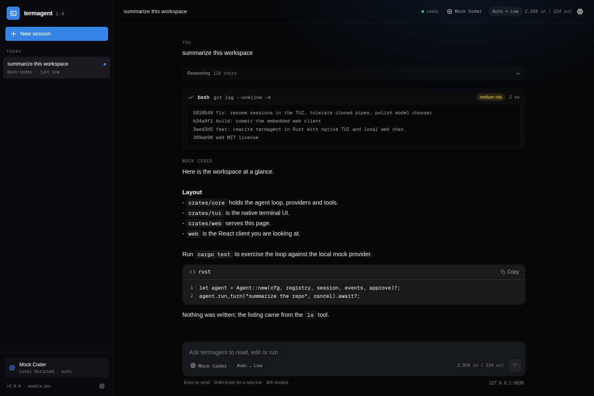
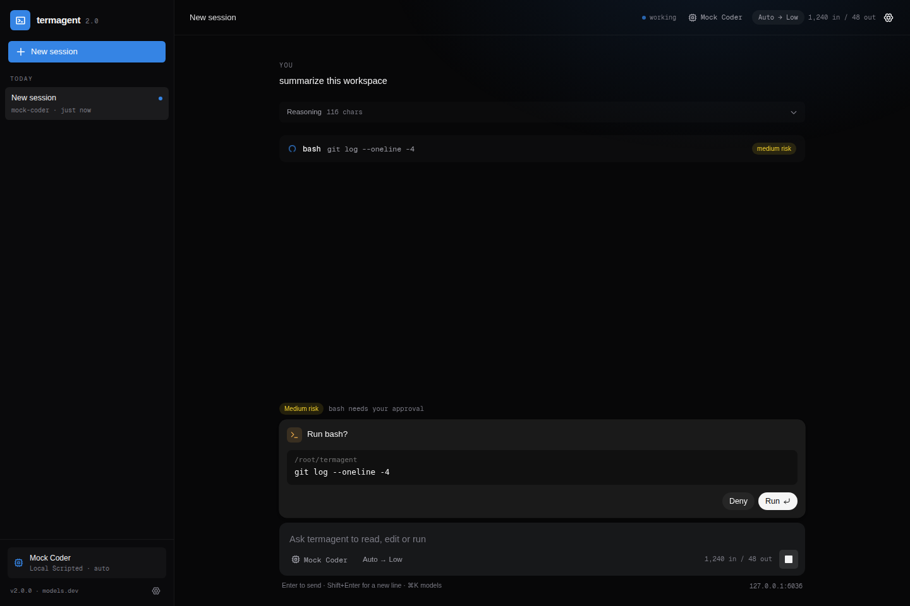
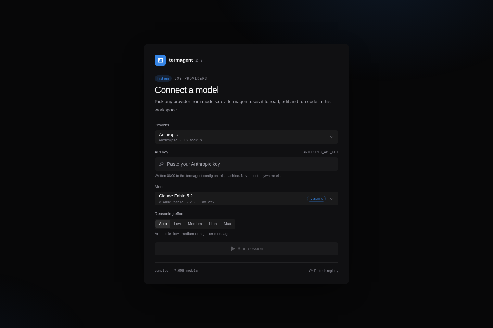
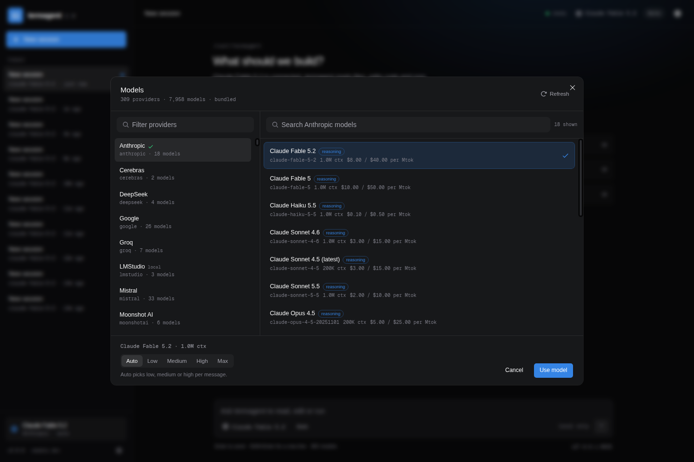

# termagent

A coding agent that runs in your terminal and your browser. One Rust binary, one
workspace, no root.

```
termagent           native terminal UI
termagent --web     local chat UI on http://127.0.0.1:6033
```

It reads files, edits them, searches, runs commands with your approval, and keeps every
session on disk. On first run it asks for a provider, a key, a model, and a reasoning
level. Providers and models come from [models.dev](https://models.dev), so the list is
current and only models that support tool calling are offered.



## What it does

- Native terminal UI: streaming replies, tool cards, approvals, model and session
  pickers, eight themes.
- Local browser UI: session sidebar, searchable model chooser, inline approvals, token
  usage, mobile layout.
- 309 providers and 7,958 tool-capable models in the bundled snapshot. Refresh from
  models.dev at any time.
- OpenAI-compatible, Anthropic, and Gemini APIs behind one agent loop.
- Per-provider keys, mode 0600, or the provider's environment variable.
- Effort control with an automatic per-message default.
- Tools: `read`, `write`, `edit`, `ls`, `glob`, `grep`, `bash`, `todo`, `webfetch`.
- Sessions as JSONL: resume, rename, delete, token totals.
- Runs in user space. It never needs sudo and refuses privilege escalation.

## See it

| Web chat | Approval gate |
|---|---|
|  |  |

| First run | Model chooser |
|---|---|
|  |  |

## Install

One command, no clone. On Termux arm64 it downloads the prebuilt binary from the latest
GitHub release, so nothing compiles on the phone. Other platforms build from source,
installing the toolchain when missing:

```sh
curl -fsSL https://raw.githubusercontent.com/loak7993-code/termagent/main/install.sh | bash
```

From a clone:

```sh
git clone https://github.com/loak7993-code/termagent
cd termagent
./install.sh
```

What it does:

- Termux arm64: downloads `termagent-aarch64-linux-android` from the latest release and
  installs it. No compiler, no Node, no root.
- Termux other architectures: `pkg install rust clang make`, then builds. No root.
- Debian, Ubuntu, Fedora, Arch: installs build packages and rustup with sudo if needed.
- macOS: uses the Xcode command line tools and rustup.
- Downloads the source tarball when the script is piped.
- Installs to `$PREFIX/bin` on Termux, `~/.local/bin` elsewhere.
- Verifies the binary with `termagent --version`.

| Option | Purpose |
|---|---|
| `--prefix DIR` | install into `DIR/bin` |
| `--add-path` | append the install directory to your shell rc |
| `--source` | always compile, skipping the prebuilt download |
| `--no-bootstrap` | fail instead of installing a toolchain |
| `--dry-run` | print the plan without changing anything |

Useful environment variables: `TERMAGENT_PREFIX`, `TERMAGENT_SRC` (existing source tree),
`TERMAGENT_JOBS` (build parallelism, for example `TERMAGENT_JOBS=2`).

Release assets:

| Asset | For |
|---|---|
| `termagent-aarch64-linux-android` | Termux on arm64 phones, Android 7+ |
| `termagent-x86_64-linux-android` | Android emulators and Chromebooks |
| `termagent-x86_64-unknown-linux-gnu` | desktop Linux, glibc 2.39 or newer |

If the download is unavailable, the installer falls back to a source build. That takes
several minutes on a phone. The installer disables thin LTO and raises codegen units on
Termux to keep memory use down; set `TERMAGENT_JOBS=1` on low-memory devices. Node is
not needed: the browser client is committed and embedded by the Rust build.

Manual build, if you already have Rust stable (tested with 1.99):

```sh
cargo build --release
mkdir -p ~/.local/bin
cp target/release/termagent ~/.local/bin/termagent
chmod 755 ~/.local/bin/termagent

# or
cargo install --path crates/cli --locked
```

First run opens the onboarding flow. Pick a provider, paste a key (or export the
provider's variable first), pick a model, pick effort, press enter. Nothing else is
required.

```sh
export ANTHROPIC_API_KEY=...   # or OPENAI_API_KEY, OPENROUTER_API_KEY, ...
termagent
```

## First run

The wizard has four fields:

1. Provider. Search all 309 registry entries. Providers whose key is already in your
   environment are marked, and popular ones are listed first.
2. API key. Stored per provider in `config.json` with mode 0600. If the provider's
   environment variable is set, you can leave this empty. Local endpoints need no key.
3. Model. Only tool-capable models are shown, with context size, price, and reasoning
   support.
4. Effort: auto, low, medium, high, max.

The same flow exists in the browser when no config is present.

## Everyday use

```sh
termagent                                  # TUI in the current directory
termagent -c <dir>                         # pick a workspace
termagent "run the tests and fix the first failure"
termagent -s <session-id>                  # resume a session
termagent --web                            # browser UI, port 6033
```

| TUI key | Action |
|---|---|
| `enter` | send |
| `esc` | stop the turn, clear input |
| `ctrl+k` | model picker |
| `ctrl+s` | sessions |
| `ctrl+e` | cycle effort |
| `ctrl+t` | cycle theme |
| `up` / `down` / `page` | scroll |
| `f1` | help |
| `ctrl+c` | quit |

Slash commands: `/model`, `/effort`, `/key`, `/sessions`, `/new`, `/theme`, `/config`,
`/tools`, `/cwd`, `/compact`, `/help`, `/exit`.

When a tool changes state, termagent asks:

```
[y] approve   [a] always allow this session   [n] deny
```

High-risk commands (recursive deletes, disk writes, piping downloads into a shell) ask
even with `--auto-approve`.

## Web mode

```sh
termagent --web              # http://127.0.0.1:6033
termagent --web --port 6044
```

The server binds loopback only. Each boot mints a new token, injects it into the page,
and requires it on the API and WebSocket. There is no CORS, no account system, and no
network exposure. Keys never reach the browser; the page only sees masked state.

```sh
termagent web: http://127.0.0.1:6033  (local only, token protected)
```

The browser UI has the same workspace as the process that started it. The session
sidebar lists saved sessions; the model dialog searches every configured provider and
loads a provider's models on demand (317 models for OpenRouter in about 30 ms).

## Providers and models

`models.dev` supplies provider metadata, environment variable names, model ids,
reasoning options, context limits, and prices. The bundled snapshot makes the first run
work offline. `termagent --refresh` or the Refresh button updates it and caches the
result for 24 hours.

| Protocol | Used by |
|---|---|
| OpenAI chat completions | OpenAI, OpenRouter, OpenCode, Groq, DeepSeek, Together-style gateways, and most registry entries |
| Anthropic Messages | Anthropic |
| Gemini generateContent | Google |

Cloud IAM providers (Amazon Bedrock, Google Vertex, Azure, GitHub Copilot) are excluded
because they cannot be set up with a single API key.

CoreWeave (W&B Inference) works with only an API key. If your account needs requests
routed through a specific Forge project, set it as `team/project`; requests then send
`OpenAI-Project`. This is optional:

```sh
termagent --project your-team/your-project
```

A bare `--base-url` becomes a `Custom endpoint` provider using the OpenAI protocol.
Local servers need no key. Start the local server first:

```sh
termagent -b http://127.0.0.1:1234/v1 -m qwen3-coder-30b   # LM Studio
termagent -b http://127.0.0.1:11434/v1 -m llama3.1         # Ollama
```

### Reasoning effort

| Level | OpenAI-compatible | Anthropic | Gemini |
|---|---|---|---|
| auto | chosen per message | chosen per message | chosen per message |
| low | `reasoning_effort: low` | 1,024 thinking tokens | 1,024 budget |
| medium | `reasoning_effort: medium` | 4,096 | 4,096 |
| high | `reasoning_effort: high` | 16,384 | 16,384 |
| max | `reasoning_effort: max` | 32,768 | 32,768 |

Auto promotes a message to high when it contains code, task verbs (refactor, debug,
test, review), more than 400 characters, or after two tool rounds. Short requests stay
low. The resolved level is visible as `Auto → High`.

## Tools and approvals

| Tool | What it does | Risk |
|---|---|---|
| `read` | numbered lines, offset and limit, binary detection | low |
| `ls` | directory listing, directories first | low |
| `glob` | find files by pattern inside the workspace | low |
| `grep` | regex search, path and line numbers | low |
| `todo` | task list for multi-step work | low |
| `write` | create or overwrite a file, creates parents | medium |
| `edit` | exact replacement, unique match required | medium |
| `bash` | shell command in the workspace, 120 s limit | medium or high |
| `webfetch` | HTTP(S) fetch, HTML reduced to text | medium |

Shell output is capped at 60k characters. Commands run with a scrubbed environment:
API keys, cloud credentials, and SSH agent sockets are removed.

## Safety

- No privilege escalation. `sudo`, `su`, `doas`, `pkexec`, and `run0` are refused before
  execution. termagent does not need root and never escalates the tools it runs.
- File tools resolve every path inside the workspace. `..` escapes and symlinks that
  point outside are rejected, including symlinked parents.
- Medium and high risk tools ask first. `--auto-approve` skips medium risk; high risk
  always asks.
- Destructive commands are classified high risk: disk writes, recursive root deletes,
  filesystem formatting, piping downloads into a shell, forced resets and pushes.
- Child processes never inherit `*_API_KEY`, `*_TOKEN`, `*SECRET*`, `*PASSWORD*`,
  `AWS_*`, `AZURE_*`, `GOOGLE_APPLICATION*`, or `SSH_AUTH_SOCK`.
- Keys are never written to session files, logs, pages, or WebSocket frames.
- No telemetry. Requests go only to the provider you configured.

## CLI

| Flag | Purpose |
|---|---|
| `--web` | serve the browser UI instead of the TUI |
| `--port <n>` | web port, 1024 to 65535, default 6033 |
| `--onboard` | force the provider, key, model, effort wizard |
| `--provider <id>` | override the provider |
| `-m, --model <id>` | override the model |
| `-b, --base-url <url>` | custom OpenAI-compatible endpoint |
| `--project <team/project>` | optional CoreWeave and W&B project |
| `-k, --api-key <key>` | key for this run; prefer environment variables |
| `--effort <level>` | auto, low, medium, high, max |
| `-c, --cwd <dir>` | workspace directory |
| `-s, --session <id>` | resume a stored session |
| `-a, --auto-approve` | skip medium-risk approvals |
| `--list-models` | print configured providers and their first models |
| `--refresh` | refresh the models.dev registry |
| `--status` | provider, model, key source, endpoint, registry, paths |
| `--version`, `--help` | version and usage |

## Authentication errors

A `401` or `403` means the provider rejected the key. It is not a network failure.

```sh
termagent --status
```

That prints the provider, model, endpoint, and key source, with the key masked. The
source tells you what to change: `config` is a key saved by onboarding, an environment
variable name means the key came from your shell, and `missing` means no key exists for
that provider.

Replace it:

```sh
termagent --onboard        # provider, then key
```

Or inside the TUI: `/key`. In the browser UI, open the gear button, choose the provider,
and paste a new key. Config keys override environment variables.

Common causes: a key from a different provider, a truncated paste, a revoked key, a
stale export in the shell. CoreWeave can optionally use a `team/project`; `termagent
--status` prints it when set.

## Configuration

Files live in `$TERMAGENT_CONFIG_DIR`, default `~/.config/termagent`:

| Path | Contents |
|---|---|
| `config.json` | provider, model, effort, per-provider keys, theme, safety flags. Mode 0600. |
| `registry.json` | models.dev cache |
| `sessions/<id>.jsonl` | one event log per session |

`config.json` fields: `provider`, `model`, `effort`, `keys`, `api_key` (legacy), `base_url`,
`project`, `system`, `max_turns`, `auto_approve`, `theme`.

| Environment variable | Purpose |
|---|---|
| `TERMAGENT_CONFIG_DIR` | config and session directory |
| `TERMAGENT_PROVIDER` | provider id |
| `TERMAGENT_MODEL` | model id |
| `TERMAGENT_BASE_URL` | custom API base URL |
| `TERMAGENT_PROJECT` / `OPENAI_PROJECT` | optional CoreWeave team/project |
| `TERMAGENT_API_KEY` | key for the active provider |
| `TERMAGENT_EFFORT` | auto, low, medium, high, max |
| `TERMAGENT_THEME` | TUI theme |
| `TERMAGENT_AUTO_APPROVE` | `1` enables auto-approve |
| `TERMAGENT_ASCII` | `1` uses ASCII borders and symbols |

Provider variables from models.dev are honored directly, for example
`ANTHROPIC_API_KEY`, `OPENAI_API_KEY`, `OPENROUTER_API_KEY`, `GROQ_API_KEY`,
`DEEPSEEK_API_KEY`.

Themes: `opencode`, `tokyo-night`, `catppuccin`, `gruvbox`, `nord`, `vercel`,
`rosepine`, `amoled`.

## Architecture

```
crates/core        agent loop, providers, tools, config, registry, sessions, safety
  providers/       openai.rs, anthropic.rs, gemini.rs, sse.rs
  tools/           read, write, edit, ls, glob, grep, bash, todo, webfetch
crates/tui         ratatui screens, key handling, worker task, themes
crates/web         axum server, REST API, WebSocket protocol, embedded assets
crates/cli         binary, flags, one-shot mode
web                Vite + React 19 client (Tailwind v4, shadcn, @aicss/react)
scripts            registry snapshot generator
docs/screenshots   captures at 390, 768, and 1440
```

The TUI owns an agent task on a two-thread Tokio runtime and exchanges events over
channels. The web server runs one conversation per process and broadcasts events over a
WebSocket. Both use the same agent loop, tools, session log, and provider adapters.

## Development

```sh
cargo build --release
cargo test --workspace          # 58 tests, no network or keys
cargo clippy --workspace --all-targets -- -D warnings
cargo fmt --check
```

The web client builds separately and is embedded by the Rust build:

```sh
cd web
npm ci
npm run build                   # writes web/dist, no source maps
cd ..
cargo build --release           # re-embeds web/dist
```

Regenerate the offline registry snapshot:

```sh
node scripts/gen_registry.mjs   # uses models.dev when no local snapshot exists
```

The design and implementation notes live in `docs/superpowers/`.

## Known limitations

- One conversation per `--web` process. Multiple tabs share it.
- No context compaction. `/new` starts a clean window, `max_turns` caps tool rounds.
- Tool arguments appear when a call completes, not while the model is composing it.
- The terminal composer is single line; long prompts scroll horizontally.
- Bedrock, Vertex, Azure, and Copilot are excluded from onboarding.
- The bundled registry is a point in time. Use `--refresh` for the newest models.
- Linux and Termux are verified. macOS is expected to work. Windows is untested.
- No MCP, image, audio, or embedding support.
- Screenshots were captured against a scripted local provider for UI verification. No
  third-party model keys were used.

## License

MIT. Built with ratatui, axum, and Tokio. The web client uses shadcn components and
`@aicss/react`. Registry data from models.dev.
